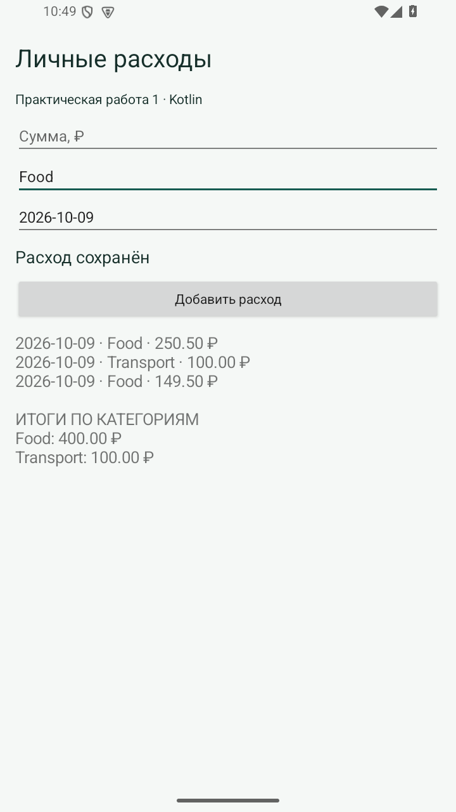

# Практическая 1. Учет личных расходов

Модуль 1. Мазенин Артем Андреевич, ИКБО-63-23.

## Задание

Создать класс расхода с суммой, категорией и датой, а также методом вывода сведений. Создать класс учета со списком расходов, добавлением записей, выводом списка и подсчетом сумм по категориям.

## Реализация

Expense содержит amount, category и date; displayInfo формирует строку одной записи. ExpenseTracker предоставляет add, all, displayAll и totalsByCategory. В последнем методе цикл проходит по всем расходам и накапливает значения в словаре по ключу категории.

MainActivity содержит поля суммы, категории и даты. При нажатии кнопки выполняются преобразование суммы, проверка точности до копеек и разбор даты LocalDate. При ошибке приложение показывает сообщение и не добавляет запись. Успешное добавление обновляет список и итоги.

В качестве дополнительной возможности список сериализуется в JSON и сохраняется в SharedPreferences. После повторного запуска восстанавливаются суммы, категории и даты. Пустой список не требует специальных действий пользователя.

## Запуск

Откройте **корень репозитория** в Android Studio, выберите модуль `pr01` и устройство API 26+. Эта папка использует общие настройки Gradle из корня.

Сборка из корня:

```powershell
.\gradlew.bat :pr01:assembleDebug
```

## Демонстрация

1. Food 250,50; Transport 100,00; Food 149,50. Ожидается: Food 400,00; Transport 100,00.
2. Закрыть и открыть приложение. Ожидается: Список и суммы восстановлены.

## Ключевой код

`src/main/java/ru/mazenin/kotlin/Expense.kt`

Объяснить отличие класса Expense от контейнера ExpenseTracker, причину использования BigDecimal и алгоритм группировки расходов.

## Скриншоты

Реальные снимки интерфейса Android-эмулятора. В работе 4 показана виртуальная камера.


