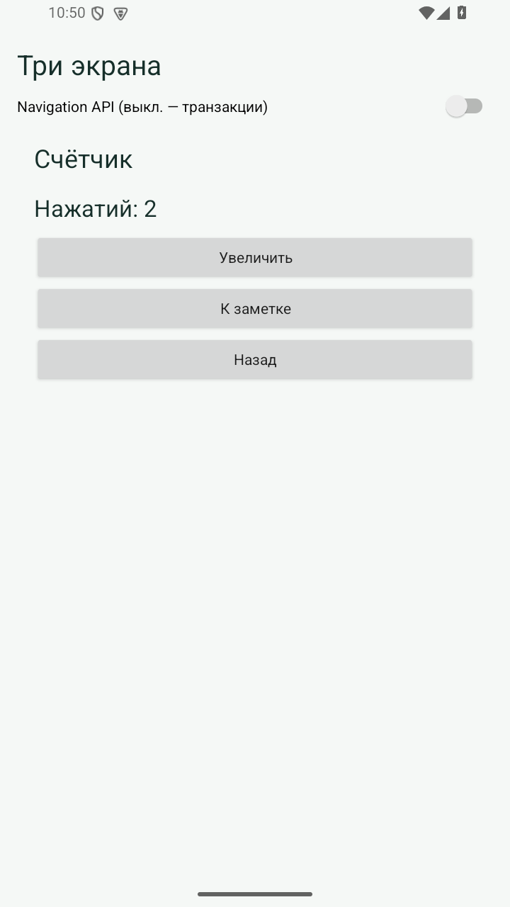
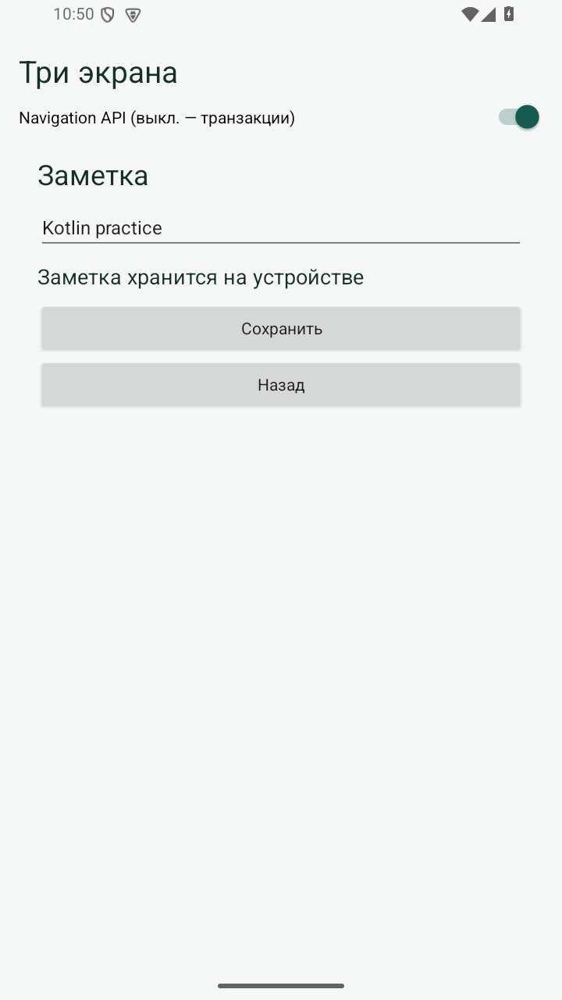

# Практическая 2. Навигация между тремя фрагментами

Модуль 1. Мазенин Артем Андреевич, ИКБО-63-23.

## Задание

Создать три фрагмента с разным наполнением и минимальной функциональностью. Реализовать два варианта навигации и возврат к предыдущему фрагменту в каждом из них.

## Реализация

HomeFragment содержит две кнопки перехода. CounterFragment отображает число нажатий и увеличивает его. NoteFragment позволяет ввести и сохранить заметку. Таким образом, каждый экран отличается и внешним видом, и действием пользователя.

Переключатель в Activity выбирает способ навигации. В ручном режиме вызываются replace и addToBackStack. В режиме Navigation создается NavHostFragment с графом main_graph, а переход выполняется методом navigate по идентификатору экрана.

Кнопка «Назад» передает действие OnBackPressedDispatcher. Для NavHost назначен основной навигационный фрагмент. При переключении режима старый стек очищается. Заметка сохраняется локально, а значение счетчика восстанавливается из состояния фрагмента при пересоздании.

## Запуск

Откройте **корень репозитория** в Android Studio, выберите модуль `pr02` и устройство API 26+. Эта папка использует общие настройки Gradle из корня.

Сборка из корня:

```powershell
.\gradlew.bat :pr02:assembleDebug
```

## Демонстрация

1. Главная → Счетчик → Заметка → Назад. Ожидается: Возврат на счетчик и главную.
2. Повторить маршрут с включенным переключателем. Ожидается: Переходы и возврат работают.
3. Ввести Kotlin practice и сохранить. Ожидается: Текст доступен при повторном открытии.

## Ключевой код

`src/main/java/ru/mazenin/kotlin/MainActivity.kt`

Показать addToBackStack, NavHostFragment и граф main_graph; объяснить, кто обрабатывает кнопку «Назад».

## Скриншоты

Реальные снимки интерфейса Android-эмулятора. В работе 4 показана виртуальная камера.




