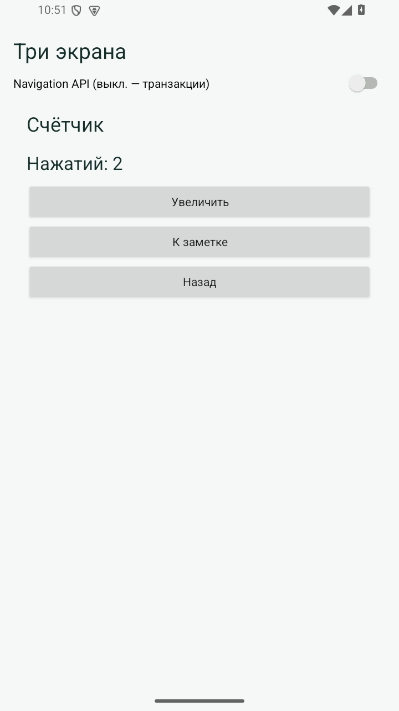
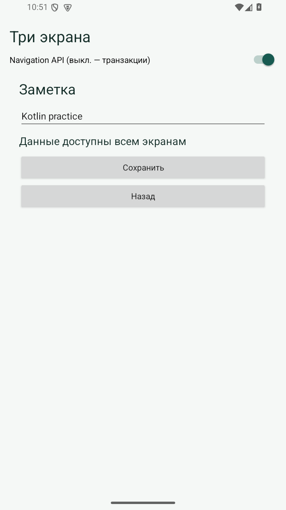
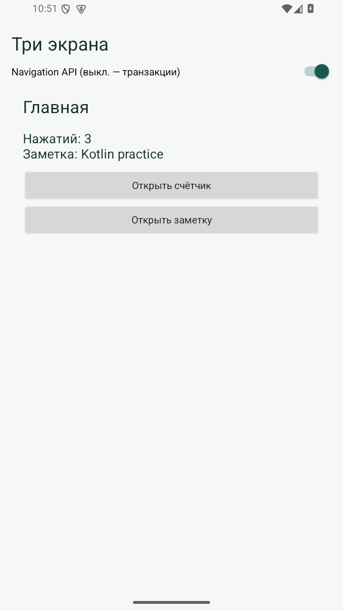

# Практическая 3. Разделение приложения на слои и MVVM

Модуль 1. Мазенин Артем Андреевич, ИКБО-63-23.

## Задание

Сохранить три экрана и навигацию предыдущей работы, разделив ответственность между представлением, предметной логикой и хранением данных.

## Реализация

В Domain находятся Workspace, интерфейс WorkspaceRepository и операция IncrementCounter. В Data размещен PreferencesRepository, который преобразует данные между Workspace и SharedPreferences. UI включает WorkspaceViewModel и фрагменты.

Общая ViewModel получается через ViewModelProvider(requireActivity()). Методы add и saveNote обновляют модель, вызывают репозиторий и публикуют новое значение LiveData. Фрагменты не обращаются к SharedPreferences напрямую.

HomeFragment наблюдает одновременно за счетчиком и заметкой, CounterFragment - за числом нажатий. Подписки создаются в onViewCreated. После изменения на одном экране актуальное состояние видно на другом. Оба варианта навигации из работы 2 сохранены.

## Запуск

Откройте **корень репозитория** в Android Studio, выберите модуль `pr03` и устройство API 26+. Эта папка использует общие настройки Gradle из корня.

Сборка из корня:

```powershell
.\gradlew.bat :pr03:assembleDebug
```

## Демонстрация

1. Изменить счетчик в двух режимах. Ожидается: Главная показывает 3 нажатия.
2. Сохранить заметку и вернуться на главную. Ожидается: На главной отображается новый текст.
3. Повторить оба варианта работы 2. Ожидается: Возврат работает.

## Ключевой код

`src/main/java/ru/mazenin/kotlin/ui/WorkspaceViewModel.kt`

Проследить путь нажатия: Fragment → ViewModel → Domain → Repository → LiveData → Fragment.

## Скриншоты

Реальные снимки интерфейса Android-эмулятора. В работе 4 показана виртуальная камера.






