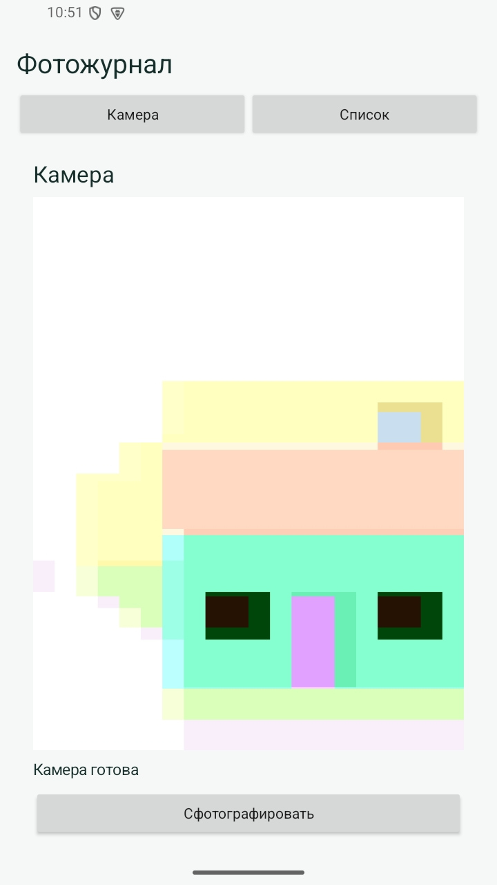
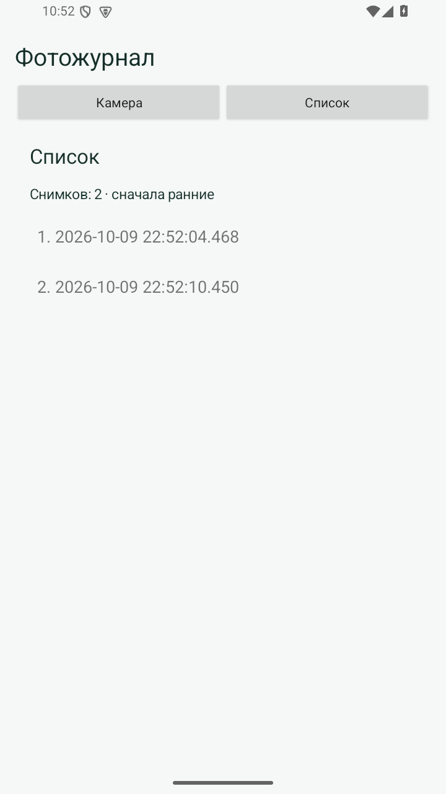

# Практическая 4. Камера и хронологический журнал снимков

Модуль 1. Мазенин Артем Андреевич, ИКБО-63-23.

## Задание

Создать экраны «Камера» и «Список». После фотографирования записывать дату и время в файл date внутри папки photos. На втором экране показать содержимое файла в хронологическом порядке.

## Реализация

Экран камеры использует SurfaceView и Camera API. После получения разрешения запускается предпросмотр. Во время фотографирования кнопка временно блокируется. JPEG записывается в filesDir/photos, затем в файл photos/date добавляется строка времени с точностью до миллисекунд.

При переходе на экран списка файл date читается, пустые строки отбрасываются, записи сортируются по возрастанию. Формат yyyy-MM-dd HH:mm:ss.SSS позволяет получить хронологический порядок обычной сортировкой строк. DatesAdapter выводит номер и время записи.

Камера освобождается при уходе с экрана и в onPause, затем открывается при возвращении. Ошибка доступа или записи отображается в статусе. Для учебного примера применен устаревший Camera API; современная альтернатива - CameraX. Проверка выполнена с виртуальной камерой эмулятора: цветная тестовая сцена является ее штатным изображением. Физическая камера телефона в проверке не использовалась.

## Запуск

Откройте **корень репозитория** в Android Studio, выберите модуль `pr04` и устройство API 26+. Эта папка использует общие настройки Gradle из корня.

Сборка из корня:

```powershell
.\gradlew.bat :pr04:assembleDebug
```

## Демонстрация

1. Разрешить камеру. Ожидается: Появляется изображение виртуальной сцены.
2. Дважды нажать фотографирование. Ожидается: Два JPEG и две строки в photos/date.
3. Открыть второй экран. Ожидается: Даты показаны от ранней к поздней.

## Ключевой код

`src/main/java/ru/mazenin/kotlin/MainActivity.kt`

Показать путь filesDir/photos/date, объяснить runtime permission, callback снимка и назначение адаптера RecyclerView.

## Скриншоты

Реальные снимки интерфейса Android-эмулятора. В работе 4 показана виртуальная камера.




