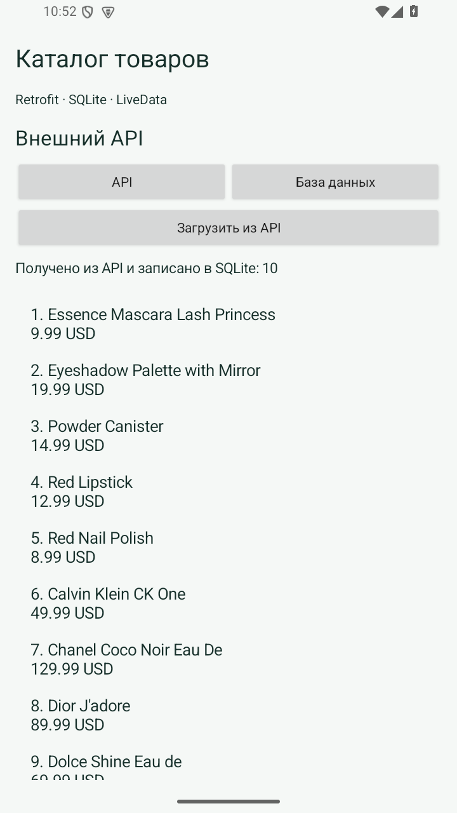
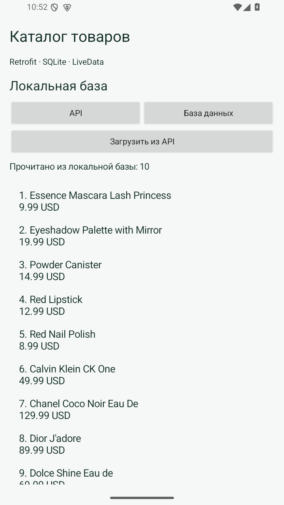

# Практическая 5. Загрузка каталога через Retrofit и хранение в SQLite

Модуль 2. Мазенин Артем Андреевич, ИКБО-63-23.

## Задание

Использовать Retrofit для получения данных, локальную базу для хранения и отдельный экран для чтения сохраненных записей.

## Реализация

Выбран учебный API DummyJSON с адресом https://dummyjson.com/products?limit=10. Product содержит id, title и price. ProductsResponse соответствует объекту ответа со списком products. Сетевой метод объявлен suspend.

CatalogDb создает таблицу products с первичным ключом id. Замена каталога выполняется транзакцией: удаление старых строк и вставка новых либо завершаются целиком, либо отменяются. При сетевой ошибке база не перезаписывается.

Экран «Внешний API» запускает загрузку и показывает полученные товары. Экран «Локальная база» читает только SQLite. Работа репозитория выполняется на Dispatchers.IO, а ViewModel публикует состояние загрузки, список и сообщение об ошибке. Для возврата в сеть используется кнопка API.

## Запуск

Откройте **корень репозитория** в Android Studio, выберите модуль `pr05` и устройство API 26+. Эта папка использует общие настройки Gradle из корня.

Сборка из корня:

```powershell
.\gradlew.bat :pr05:assembleDebug
```

## Демонстрация

1. Загрузить из API. Ожидается: 10 товаров получены и сохранены.
2. Открыть «База данных». Ожидается: Прочитано 10 записей.
3. Отключить сеть и перезапустить приложение. Ожидается: 10 товаров доступны из SQLite.

## Ключевой код

`src/main/java/ru/mazenin/kotlin/Catalog.kt`

Объяснить @GET, ProductsResponse, suspend, транзакцию SQLite и отличие сетевого экрана от локального.

## Скриншоты

Реальные снимки интерфейса Android-эмулятора. В работе 4 показана виртуальная камера.






