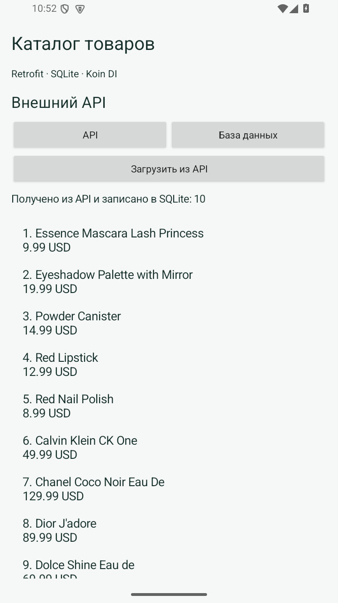
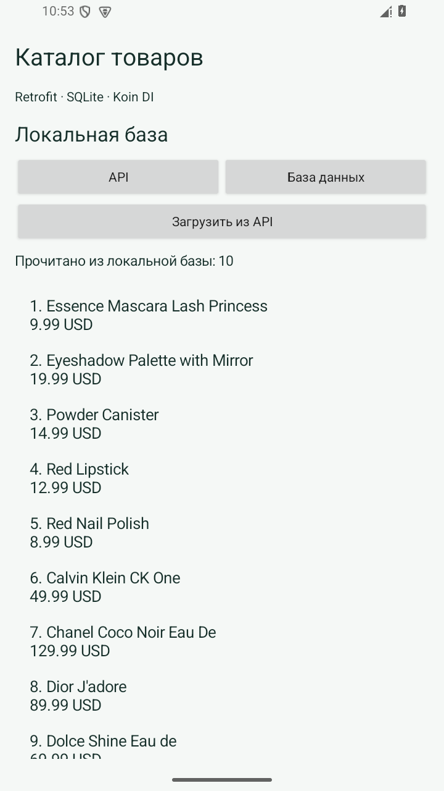

# Практическая 6. Внедрение зависимостей с помощью Koin

Модуль 2. Мазенин Артем Андреевич, ИКБО-63-23.

## Задание

Применить одну из библиотек Dagger, Hilt или Koin для создания и передачи зависимостей существующего приложения.

## Реализация

CatalogApplication инициализирует startKoin один раз при запуске процесса и передает Android Context. В catalogModule объявлены singleton-компоненты API, базы и репозитория. ViewModel зарегистрирована отдельным определением viewModel.

В MainActivity модель получается делегатом by viewModel(). Activity больше не создает Retrofit, CatalogDb и фабрику вручную. Классы каталога, структура базы и экранные сценарии сохранены из практической работы 5.

Такое разделение позволяет заменить реализацию зависимости в конфигурации контейнера. При этом сама библиотека DI не выполняет HTTP-запросы и не хранит данные: эти обязанности остаются у Retrofit, репозитория и SQLite.

## Запуск

Откройте **корень репозитория** в Android Studio, выберите модуль `pr06` и устройство API 26+. Эта папка использует общие настройки Gradle из корня.

Сборка из корня:

```powershell
.\gradlew.bat :pr06:assembleDebug
```

## Демонстрация

1. Запустить приложение. Ожидается: ViewModel и зависимости получены без ошибки.
2. Выполнить загрузку через API. Ожидается: 10 товаров сохранены.
3. Отключить сеть и открыть базу. Ожидается: Сохраненные товары доступны.

## Ключевой код

`src/main/java/ru/mazenin/kotlin/CatalogApplication.kt`

Показать catalogModule, объяснить single, get, viewModel и роль Application при старте контейнера.

## Скриншоты

Реальные снимки интерфейса Android-эмулятора. В работе 4 показана виртуальная камера.





