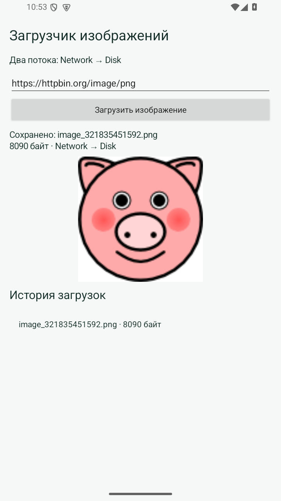
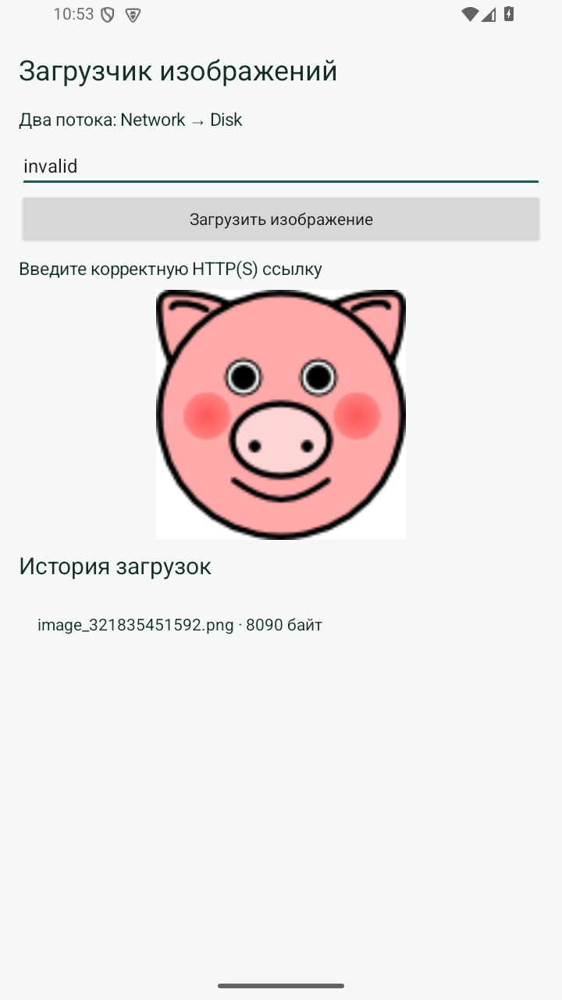

# Практическая 8. Модульное и интерфейсное тестирование загрузчика

Модуль 2. Мазенин Артем Андреевич, ИКБО-63-23.

## Задание

Добавить ровно пять тестов логики и пять тестов элементов пользовательского интерфейса. Сохранить работоспособность приложения из предыдущей работы.

## Реализация

ImageDownloaderTest проверяет нормализацию URL, отклонение неверных схем, распознавание PNG/JPEG, отклонение HTML и полную цепочку загрузки с записью файла. Последний тест сравнивает сохраненные байты с исходными и проверяет имена Network и Disk.

DownloaderUiTest использует ActivityScenarioRule. Проверяются начальный URL, доступность кнопки, редактирование поля, сообщение при пустой ссылке и видимость заголовка истории. Поиск элементов выполняется по resource ID, а не координатам.

Реальная сеть не используется в автоматических тестах, поэтому временная недоступность внешнего сайта не влияет на их результат. Отдельная экранная проверка выполняет настоящую загрузку. Ошибка ввода показана на отдельном снимке приложения.

## Запуск

Откройте **корень репозитория** в Android Studio, выберите модуль `pr08` и устройство API 26+. Эта папка использует общие настройки Gradle из корня.

Сборка из корня:

```powershell
.\gradlew.bat :pr08:assembleDebug
```

## Демонстрация

1. 5 тестов логики. Ожидается: 5 пройдено, ошибок 0.
2. 5 тестов интерфейса. Ожидается: 5 пройдено, ошибок 0.
3. Реальная загрузка и неверная ссылка. Ожидается: Файл сохранен; ошибка ввода показана.

## Ключевой код

`src/main/java/ru/mazenin/kotlin/ImageDownloader.kt`

Показать оба набора тестов и объяснить различие локального JVM-теста, инструментального теста и сетевой проверки.

## Тесты

`./gradlew :pr08:testDebugUnitTest` - 5 тестов JUnit 4.

`./gradlew :pr08:connectedDebugAndroidTest` - 5 тестов Espresso; требуется устройство. В Windows используйте `gradlew.bat`.


## Скриншоты

Реальные снимки интерфейса Android-эмулятора. В работе 4 показана виртуальная камера.




