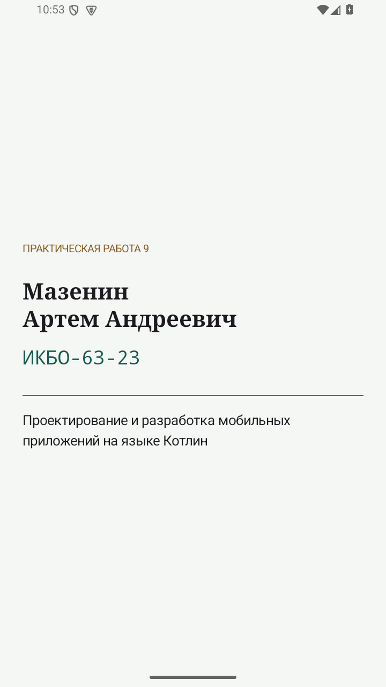

# Практическая 9. Персональная тема Jetpack Compose

Модуль 3. Мазенин Артем Андреевич, ИКБО-63-23.

## Задание

Вывести ФИО и номер группы посредством Text и применить собственный набор стилей приложения.

## Реализация

StudentTheme определяет светлую палитру с зеленым основным цветом и светлым фоном. Для крупного заголовка выбрана Serif, для основного текста SansSerif, а номер группы отображается Monospace. Размеры и межстрочные интервалы заданы явно.

MainActivity вызывает setContent и помещает Surface и Column внутрь StudentTheme. ФИО «Мазенин Артем Андреевич» и группа «ИКБО-63-23» выводятся отдельными Text. На том же экране указаны номер работы и название дисциплины.

safeDrawingPadding учитывает системные панели. Цвета и стили получаются через MaterialTheme, поэтому оформление задается централизованно и может быть повторно использовано в следующих работах.

## Запуск

Откройте **корень репозитория** в Android Studio, выберите модуль `pr09` и устройство API 26+. Эта папка использует общие настройки Gradle из корня.

Сборка из корня:

```powershell
.\gradlew.bat :pr09:assembleDebug
```

## Демонстрация

1. Открыть приложение. Ожидается: Мазенин Артем Андреевич.
2. Проверить Text. Ожидается: ИКБО-63-23.
3. Проверить экран на эмуляторе. Ожидается: Собственная палитра, разные гарнитуры и размеры.

## Ключевой код

`src/main/java/ru/mazenin/kotlin/StudentTheme.kt`

Показать StudentTheme, MaterialTheme.typography и отличие dp от sp.

## Скриншоты

Реальные снимки интерфейса Android-эмулятора. В работе 4 показана виртуальная камера.


