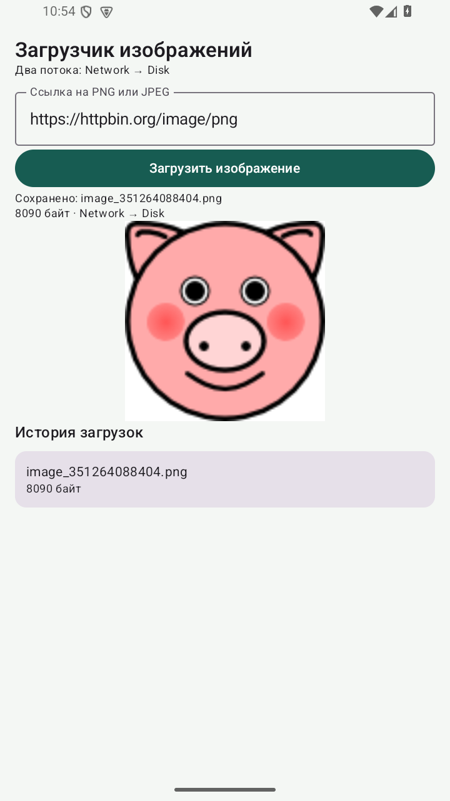

# Практическая 10. Перенос загрузчика изображений на Compose

Модуль 3. Мазенин Артем Андреевич, ИКБО-63-23.

## Задание

Сохранить расположение основных элементов загрузчика из работы 7 и использовать изученные контейнеры компоновки и LazyColumn либо LazyRow.

## Реализация

Расположение основных элементов сохранено: заголовок и подпись потоков, поле ссылки, кнопка на ширину экрана, статус, предпросмотр и история. Экран описан в DownloadScreen. Поле хранит ввод через rememberSaveable, а ImageState поступает из той же модели, что использовалась в работе 7.

Кнопка находится в Row, предпросмотр - в Box, запись файла - в Card. История выводится LazyColumn с устойчивым ключом имени файла. После успешной загрузки новый ImageState автоматически вызывает обновление интерфейса.

Сетевой и файловый код перенесены без изменения назначения потоков. Приложение по-прежнему получает реальное изображение по URL и сохраняет его во внутренней памяти. Изменен способ построения UI, а не алгоритм обработки данных.

## Запуск

Откройте **корень репозитория** в Android Studio, выберите модуль `pr10` и устройство API 26+. Эта папка использует общие настройки Gradle из корня.

Сборка из корня:

```powershell
.\gradlew.bat :pr10:assembleDebug
```

## Демонстрация

1. Открыть приложение. Ожидается: Порядок полей соответствует работе 7.
2. Нажать кнопку. Ожидается: Появляется предпросмотр и статус Network → Disk.
3. Проверить историю. Ожидается: Новый файл добавлен в Card.

## Ключевой код

`src/main/java/ru/mazenin/kotlin/ImageScreens.kt`

Найти Column, Row, Box, Card и LazyColumn; объяснить источник данных для повторной композиции.

## Скриншоты

Реальные снимки интерфейса Android-эмулятора. В работе 4 показана виртуальная камера.


