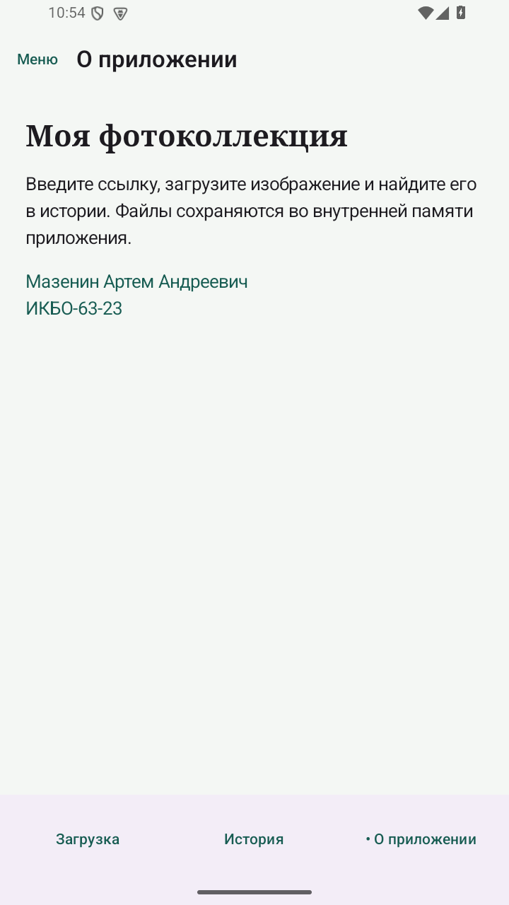
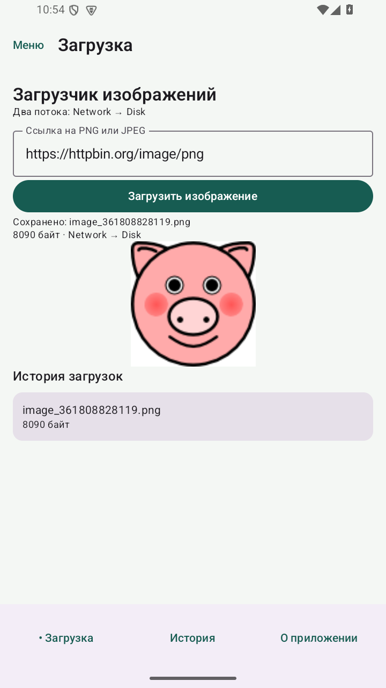
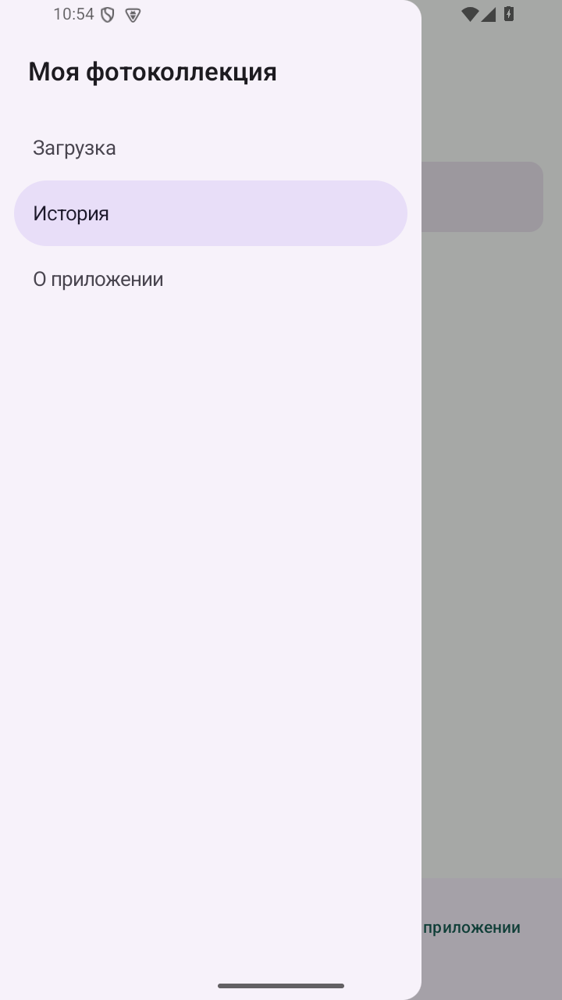
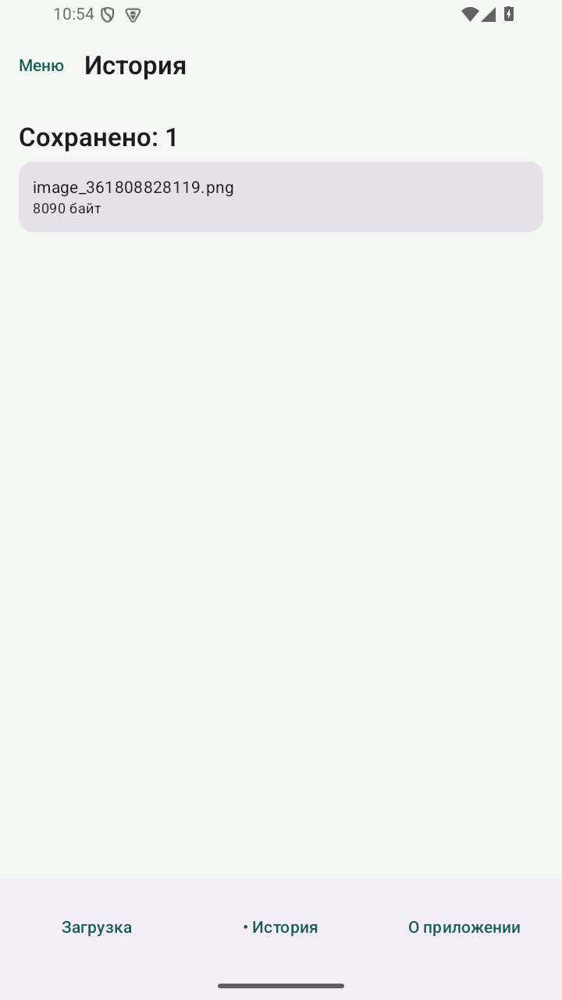

# Практическая 11. Scaffold и две панели переходов

Модуль 3. Мазенин Артем Андреевич, ИКБО-63-23.

## Задание

Показывать название текущего экрана в верхней панели, его содержимое в основной области и обеспечить доступ к каждому экрану через нижнюю панель и боковое меню.

## Реализация

Созданы разделы «Загрузка», «История» и «О приложении». AppShell хранит текущий маршрут в rememberSaveable. Один список pages используется для обоих меню и заголовка TopAppBar, что исключает несовпадение названий.

BottomAppBar содержит по кнопке на каждый раздел. В ModalDrawerSheet размещены NavigationDrawerItem. При выборе пункта изменяется текущий маршрут и закрывается боковое меню. Scaffold передает внутренние отступы содержимому экрана.

Состояние ImageViewModel общее для всех разделов. Загруженное изображение сразу появляется в истории. Кнопка «Назад» из вспомогательного раздела возвращает на загрузку. В данной работе выбор раздела реализован состоянием Compose; Navigation Component добавляется в работе 12.

## Запуск

Откройте **корень репозитория** в Android Studio, выберите модуль `pr11` и устройство API 26+. Эта папка использует общие настройки Gradle из корня.

Сборка из корня:

```powershell
.\gradlew.bat :pr11:assembleDebug
```

## Демонстрация

1. Загрузка → История. Ожидается: Заголовок и содержимое меняются.
2. Меню → О приложении. Ожидается: Открыт выбранный раздел.
3. Загрузить файл и открыть историю. Ожидается: Файл доступен на отдельном экране.

## Ключевой код

`src/main/java/ru/mazenin/kotlin/MainActivity.kt`

Показать слоты topBar и bottomBar, content padding и общее состояние выбора раздела.

## Скриншоты

Реальные снимки интерфейса Android-эмулятора. В работе 4 показана виртуальная камера.








