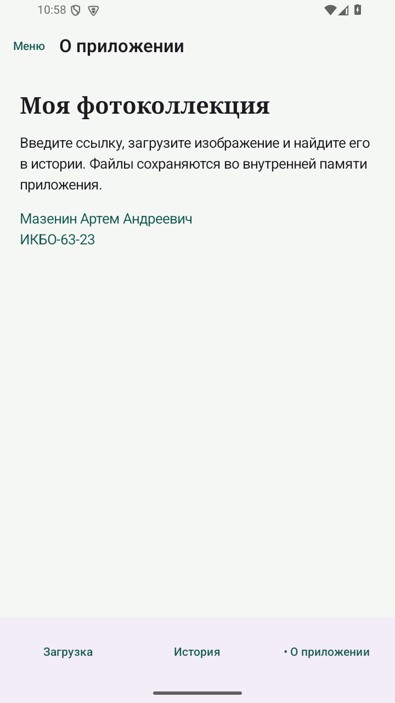
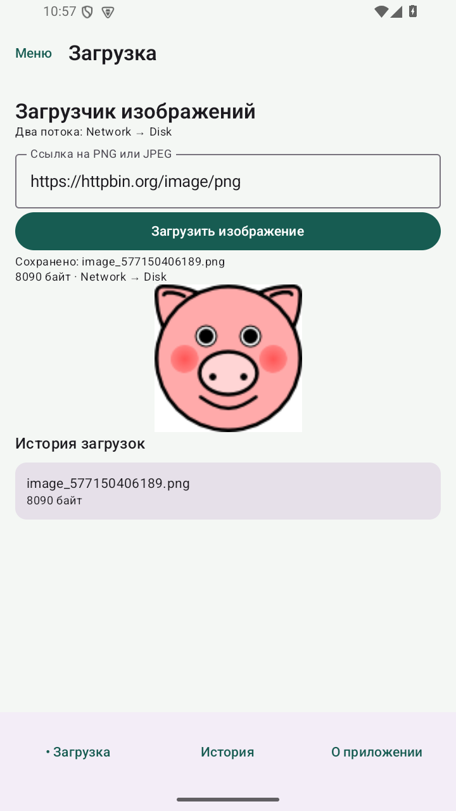
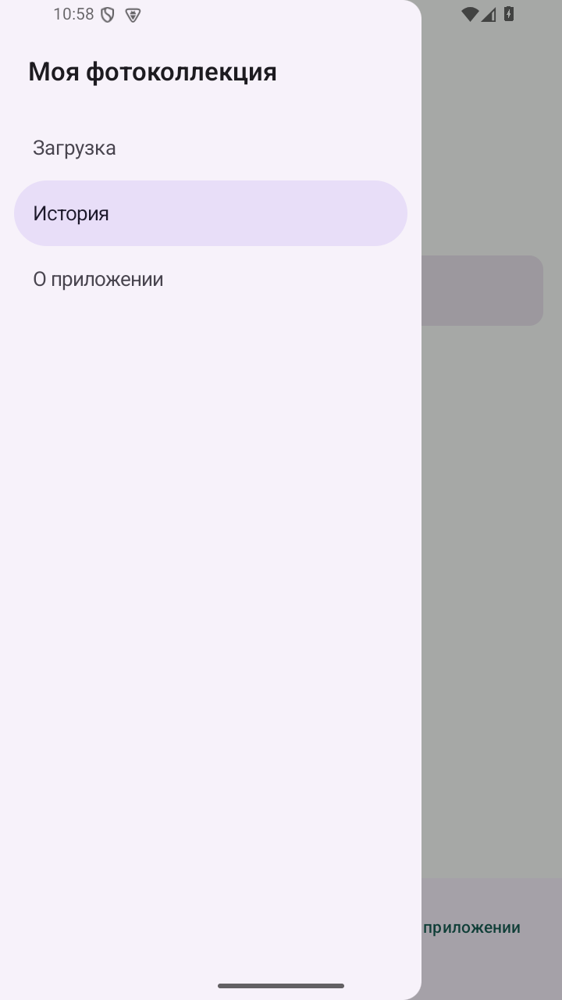
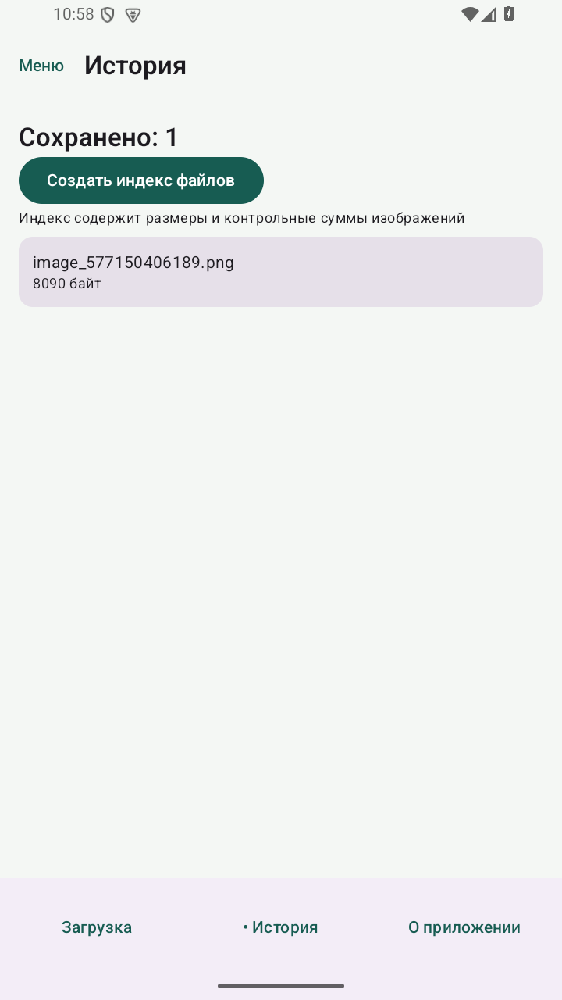
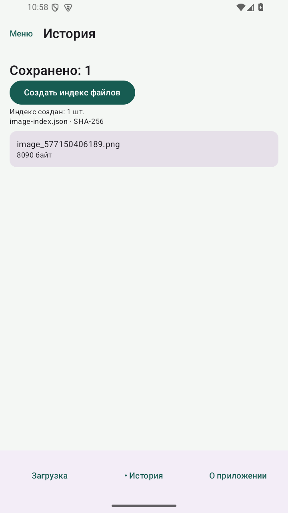

# Практическая 12. Граф навигации и фоновый индекс изображений

Модуль 3. Мазенин Артем Андреевич, ИКБО-63-23.

## Задание

Реализовать навигацию между экранами и добавить WorkManager, выполняющий задачу по тематике приложения.

## Реализация

Маршруты download, history и about зарегистрированы в NavHost. Оба меню вызывают navigate; launchSingleTop препятствует дублированию вершины стека. popUpTo, saveState и restoreState используются при переключении разделов. Заголовок вычисляется из текущей записи стека.

На экране истории кнопка «Создать индекс файлов» ставит уникальную задачу image-index с политикой KEEP. ImageIndexWorker читает сохраненные PNG/JPEG, вычисляет SHA-256 и записывает image-index.json. Для каждого файла сохраняются имя, размер и контрольная сумма.

Worker выполняет файловую работу на Dispatchers.IO и возвращает количество обработанных изображений. UI наблюдает WorkInfo и показывает ожидание, выполнение, успех либо ошибку. Повторное нажатие во время активной задачи не создает дубликат.

## Запуск

Откройте **корень репозитория** в Android Studio, выберите модуль `pr12` и устройство API 26+. Эта папка использует общие настройки Gradle из корня.

Сборка из корня:

```powershell
.\gradlew.bat :pr12:assembleDebug
```

## Демонстрация

1. Перейти через меню и нажать Назад. Ожидается: Возврат на загрузку.
2. Создать индекс после загрузки изображения. Ожидается: SUCCEEDED; обработан 1 файл.
3. Прочитать image-index.json. Ожидается: Имя, размер и SHA-256 сохранены.

## Ключевой код

`src/main/java/ru/mazenin/kotlin/ImageIndexWorker.kt`

Объяснить стек NavController, уникальную работу KEEP, CoroutineWorker и наблюдение за WorkInfo.

## Скриншоты

Реальные снимки интерфейса Android-эмулятора. В работе 4 показана виртуальная камера.










